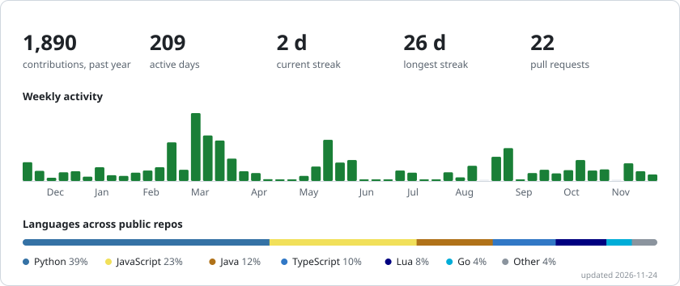

<h1>I build software. Then I keep it running.</h1>

I'm Konstantin, a Python developer and server administrator. 
Backend, bots, and the infrastructure under them.

**10 years** on GitHub · **3,700+** mod downloads · **8** languages

 

## Your VPN drops. Your apps go dark.

**KillSwitch** is a per-app internet kill switch for Windows, written in Rust. 
If the network state can't be read, the apps are blocked. The block survives a crash or a reboot.

[See the code](https://github.com/BazZziliuS/KillSwitch) · [Download](https://github.com/BazZziliuS/KillSwitch/releases)

 

## What I do

**Backend and APIs.** Async Python services, webhook integrations, and API client libraries published on PyPI.

**Bots and automation.** Telegram and Discord bots with clean architecture, migrations, and localization.

**Infrastructure.** Linux servers, Docker deployments, CI/CD pipelines, and monitoring. Currently server administrator at **CenturyMine Network**.

**Native and game tooling.** Windows utilities in Rust, desktop apps in Electron and PyQt, and Minecraft mods in Java.

**AI-assisted engineering.** Coding agents across the whole cycle: writing and refactoring code, review, debugging, tests, and documentation. LLMs built into bots and services.

 

## By the numbers

<picture>
  <source media="(prefers-color-scheme: dark)" srcset="assets/stats-dark.svg">
  
</picture>

Rendered daily by a small script in this repo straight from the GitHub API. No third-party stat services.

 

## More work

| Project | What it does | Built with |
| :-- | :-- | :-- |
| **[boostylib](https://github.com/BazZziliuS/boostylib)** | Async Python library for the Boosty API, [published on PyPI](https://pypi.org/project/boostylib/). | Python, httpx, Pydantic, pytest |
| **[Cloudea Blog](https://github.com/BazZziliuS/cloudea-blog)** | [Blog and documentation platform](https://blog.cloudea.org/) with automated releases. | Next.js, React, Tailwind CSS, Supabase, Playwright |
| **[AioFrame](https://github.com/BazZziliuS/AioFrame)** | Telegram bot template with a repository layer, migrations, and i18n. | Python, aiogram, SQLAlchemy, Alembic |
| **[StealthChat](https://github.com/BazZziliuS/StealthChat)** | Chrome extension that adds end-to-end encryption to web messengers. | JavaScript, Chrome Extensions |
| **[Mekanism Stack Processor](https://github.com/BazZziliuS/Mekanism-Stack-Processor)** | Minecraft mod that adds batch processing to Mekanism machines. 3,700+ downloads on Modrinth and CurseForge. | Java, NeoForge, Gradle |

 

## The stack

  <picture>
    <source media="(prefers-color-scheme: dark)" srcset="assets/stack-dark.svg">
    
  </picture>

| | |
| :-- | :-- |
| **Languages** | Python · Java · Kotlin · TypeScript · JavaScript · Rust · Go · Lua |
| **Backend** | FastAPI · SQLAlchemy · Alembic · Pydantic · httpx · aiohttp · APScheduler |
| **Bots** | aiogram · Disnake |
| **Frontend** | Next.js · React · Tailwind CSS · shadcn/ui |
| **Desktop** | Electron · PyQt6 · egui · Windows API |
| **Data** | PostgreSQL · SQLite · Supabase |
| **Testing and quality** | pytest · Vitest · Playwright · Ruff · mypy |
| **DevOps** | Linux · Docker · Docker Compose · GitHub Actions · semantic-release · Git |
| **Game development** | NeoForge · Mixin · Gradle · KubeJS · GravitLauncher · RCON |
| **AI** | Claude Code · ChatGPT · Codex · Local LLMs (Gemma, Qwen) · LLM APIs · MCP |

 

## Get in touch

[Discord](https://fuix.io/discord) &nbsp;·&nbsp; [YouTube](https://youtube.com/@BazZziliuS) &nbsp;·&nbsp; [Blog](https://blog.cloudea.org/)
