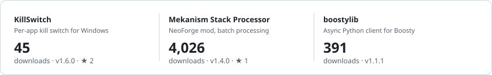
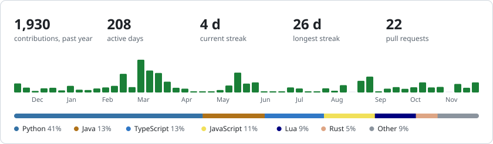
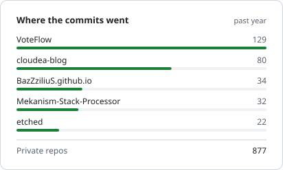
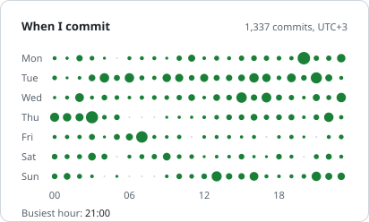

<h1>I build software. Then I keep it running.</h1>

Konstantin · Python developer and server administrator at **CenturyMine Network** 
Backend, bots, and the infrastructure under them.

 

<picture>
  <source media="(prefers-color-scheme: dark)" srcset="assets/shipped-dark.svg">
  
</picture>

[KillSwitch](https://github.com/BazZziliuS/KillSwitch) · [Mekanism Stack Processor](https://github.com/BazZziliuS/Mekanism-Stack-Processor) · [boostylib](https://github.com/BazZziliuS/boostylib)

 

<picture>
  <source media="(prefers-color-scheme: dark)" srcset="assets/overview-dark.svg">
  
</picture>

<picture>
  <source media="(prefers-color-scheme: dark)" srcset="assets/focus-dark.svg">
  
</picture>
<picture>
  <source media="(prefers-color-scheme: dark)" srcset="assets/hours-dark.svg">
  
</picture>

  

<!-- live:start -->
<table><tr><td valign="top" width="50%">

<b>Now building</b>

- [cloudea-blog](https://github.com/BazZziliuS/cloudea-blog) 13 commits in 2 weeks A modern blog and documentation platform.
- [AioFrame](https://github.com/BazZziliuS/AioFrame) 8 commits in 2 weeks Telegram bot template on aiogram 3: async SQLAlchemy, Alembic, repository pattern, i18n, admin panel, Docker
- [boostylib](https://github.com/BazZziliuS/boostylib) 1 commit in 2 weeks Async Python client for the Boosty API: subscriptions, posts, donations. On PyPI.

</td><td valign="top" width="50%">

<b>Latest posts</b>

- [KillSwitch: отключаю интернет отдельным программам, когда падает VPN](https://blog.cloudea.org/blog/2026/11-24-killswitch) Nov 2026
- [ЯПульт: как я вайбкодил пульт от умного дома, чтобы не жонглировать гаджетами](https://blog.cloudea.org/blog/2026/07-11-ya-pult-vibe-coding) Jul 2026
- [StealthChat: спрятал сообщения в обычных предложениях — и заметил, что кошельки делают тот же трюк](https://blog.cloudea.org/blog/2026/03-24-stealthchat-wallet-keys) Mar 2026

</td></tr></table>
<!-- live:end -->

 

<picture>
  <source media="(prefers-color-scheme: dark)" srcset="assets/stack-dark.svg">
  
</picture>

  

Also: [StealthChat](https://github.com/BazZziliuS/StealthChat) E2E for web messengers · [Cloudea Blog](https://blog.cloudea.org/)

[Discord](https://fuix.io/discord) · [YouTube](https://youtube.com/@BazZziliuS) · [Blog](https://blog.cloudea.org/)

Cards are rendered daily from the GitHub, Modrinth, CurseForge and PyPI APIs by <a href="scripts/stats.py">scripts/stats.py</a>.

